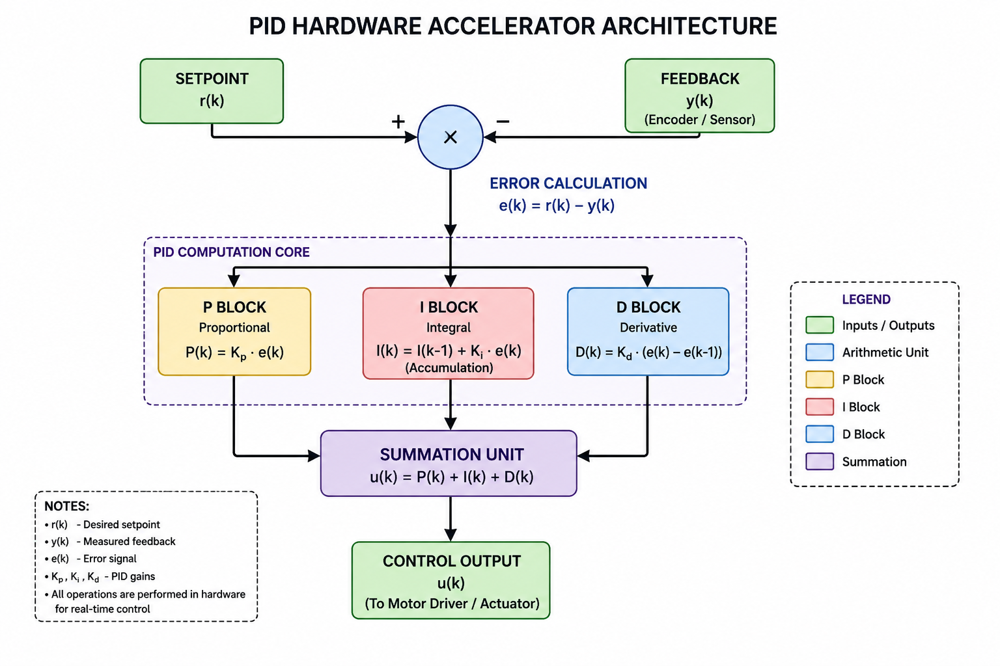
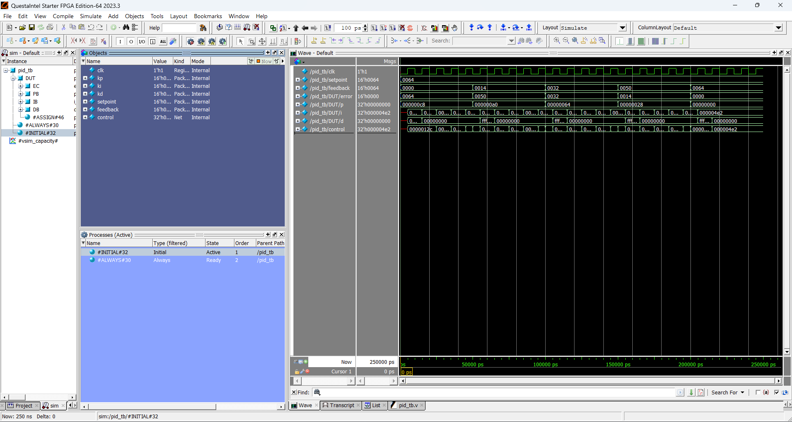

#PID Hardware Accelerator

## Why I Built This

For a long time, I was fascinated by robotics because of what robots do — moving, interacting with environments, manipulating objects, and performing tasks autonomously.

While working with robotic systems and control loops, I kept wondering:

> What actually happens underneath all this movement?

Every robotic action relies on continuous computation happening in the background.

Processors repeatedly execute control instructions thousands of times every second:

```c
error = setpoint-feedback;

P = Kp*error;
I = Ki*sum(error);
D = Kd*(error-prev_error);

control = P+I+D;
```

I started asking:

> If these computations are repetitive, deterministic, and mathematically simple, why repeatedly execute software instructions for them?

This project represents my first deliberate step toward combining:

- Robotics
- VLSI
- Hardware acceleration
- Embedded systems

Rather than leaving robotics behind, I wanted to understand and build the hardware that makes robotic systems possible.

This project serves as my first exploration of that direction.

---

## Objective

Design and verify a synthesizable RTL-based hardware accelerator for real-time PID control by moving repetitive control computations from sequential software execution into dedicated parallel hardware blocks.

Goals:

- Reduce processor workload
- Enable deterministic execution
- Explore hardware/software co-design
- Begin exploring VLSI for robotic systems

---

## Key Features

- Modular RTL architecture
- Dedicated P, I, and D hardware blocks
- Synthesizable Verilog implementation
- Functional verification using QuestaSim
- Intel Quartus synthesis compatibility
- Hardware offloading of control computations

---

## Architecture



Control flow:

```text
Setpoint + Feedback
          ↓
 Error Calculation
          ↓
 ┌─────────────────┐
 │ P     I     D   │
 └─────────────────┘
          ↓
     Summation
          ↓
   Control Output
```

---

## Simulation Waveform



---

## Simulation Results

### Input Parameters

- Kp = 2
- Ki = 1
- Kd = 1
- Setpoint = 100

### Feedback Progression

```text
0 → 20 → 50 → 80 → 100
```

### Error Progression

```text
100 → 80 → 50 → 20 → 0
```

### Observations

✅ Correct error computation

✅ Proportional response decreases with decreasing error

✅ Integral term accumulates historical error

✅ Derivative spikes during transitions

✅ Successful functional verification of hardware

---

## Detailed Results

See:

[Simulation Results](docs/results.md)

---

## Project Status

Current Version: **V1 Complete** ✅

Completed:

- RTL implementation
- Functional simulation
- Quartus synthesis
- Waveform verification

Planned:

- Fixed-point arithmetic
- Anti-windup circuitry
- PWM generation
- FPGA deployment

---

## Current Limitation

Simulation revealed continuous accumulation of the integral term:

- Integral windup observed

This motivates future improvements:

- Anti-windup circuitry
- Saturation logic
- Fixed-point implementation

---

## Future Direction

I do not see this as a standalone project.

I see it as the beginning of a broader path:

```text
Robotics
    ↓
Control Systems
    ↓
Hardware Acceleration
    ↓
VLSI
```

Future projects I want to explore:

- Hardware inverse kinematics engines
- RISC-V robotic co-processors
- Motion-control processors
- Space robotics hardware accelerators

---

## Tools Used

- Verilog HDL
- Intel Quartus Prime
- QuestaSim

---

## Author

Ashmit Singh  
Electronics Engineering (VLSI Design and Technology)  
VIT Vellore
